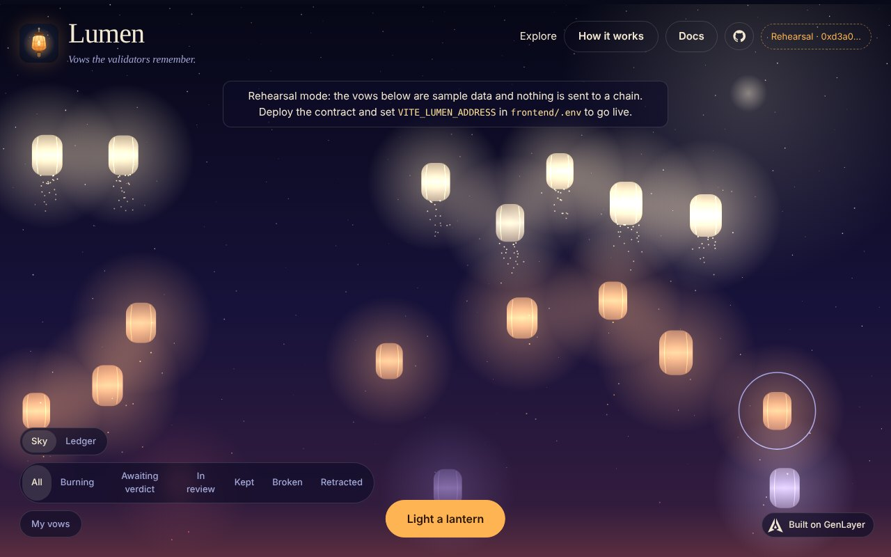
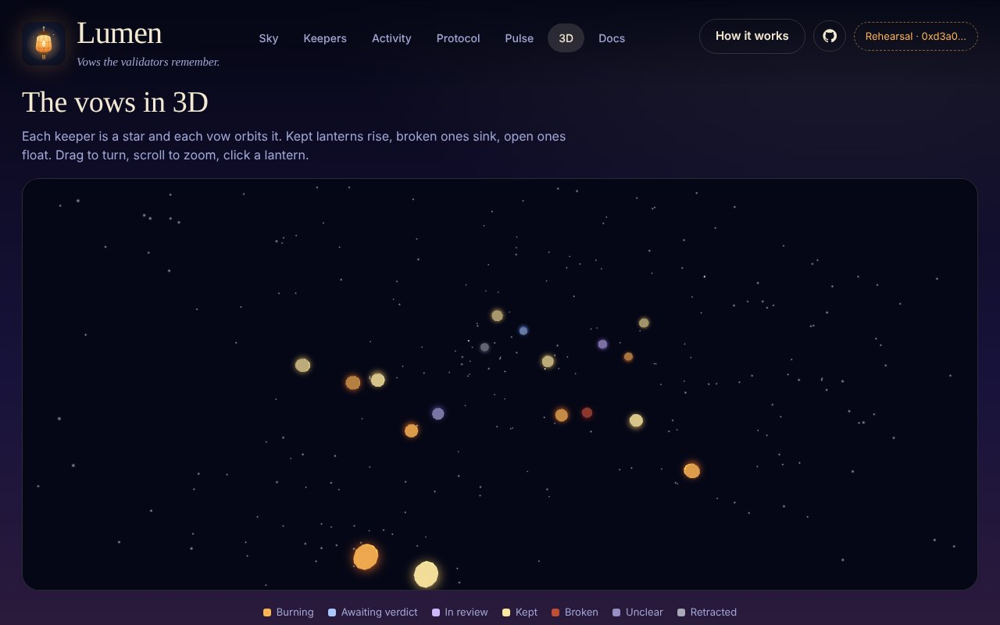
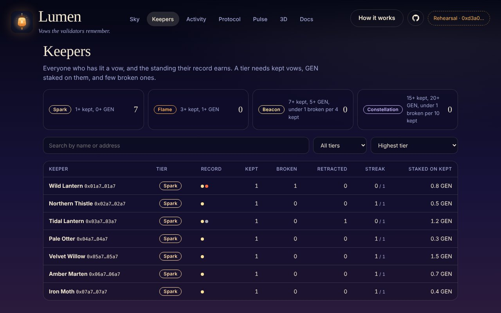
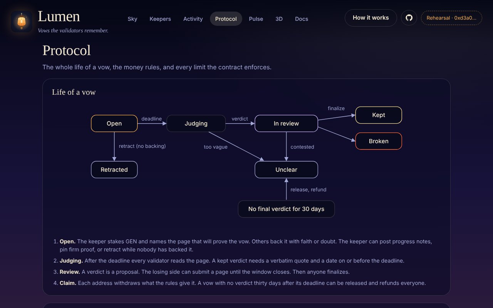
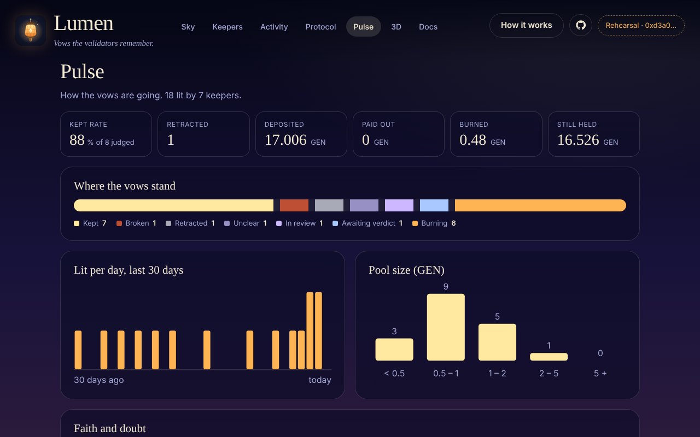
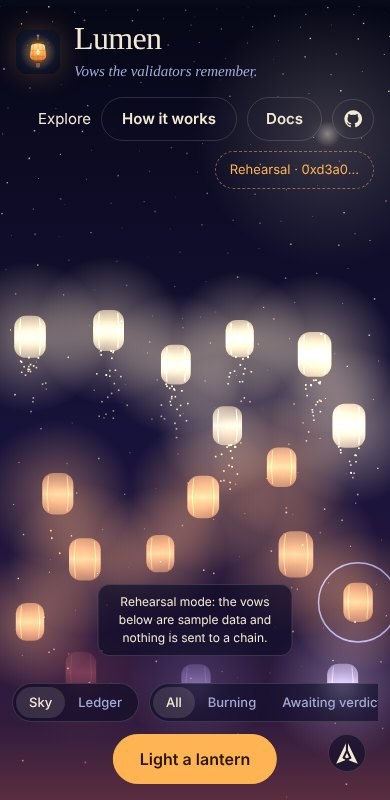

<p align="center">
  
</p>

<p align="center">
  <a href="https://www.genlayer.com">
    <picture>
      <source media="(prefers-color-scheme: dark)" srcset="docs/genlayer-logo-cream.svg" />
      <source media="(prefers-color-scheme: light)" srcset="docs/genlayer-logo-black.svg" />
      
    </picture>
  </a>
</p>

<p align="center"><b>Built on GenLayer</b> &middot; <a href="https://github.com/reza9133/lumen">GitHub</a> &middot; <a href="docs/MILESTONE.md">What is new in v2</a> &middot; <a href="CHANGELOG.md">Changelog</a> &middot; <a href="frontend/docs.html">In-app documentation</a></p>

# Lumen

Public vows, judged by validators. Write a promise, stake GEN behind it and point to the page that will prove it. After the deadline every GenLayer validator reads that page and rules whether the vow was kept. Friends back it with faith, skeptics bet against it, and every broken vow sends embers drifting down the sky.

Version 2 adds retraction, public progress notes, an activity feed, keeper tiers and an incremental sync that makes an idle client read 25 bytes instead of about 30 KB. The app has a keeper directory, keeper pages, a protocol page with a payout calculator, pulse charts and a 3D view, and it runs on sample data until you give it a contract.

## Live on Studionet

Version 2.0.0 is deployed at `0x65b24E33838f738C74304Ba6c03A3787bB0C4360`. A full automated run against it passed 223 of 223 checks (82 transactions; kept, broken and retracted vows; every payout equal to an independent calculation). The report is in [`evidence/live-e2e/2026-11-13T10-13-50Z/REPORT.md`](evidence/live-e2e/2026-11-13T10-13-50Z/REPORT.md). To point the app at it, put `VITE_LUMEN_ADDRESS=0x65b24E33838f738C74304Ba6c03A3787bB0C4360` in `frontend/.env`.

## Screenshots

Captured by `npm run smoke` in rehearsal mode, so the vows are sample data.

| | |
|---|---|
|  |  |
| The sky (`#/`) | The 3D view (`#/space`) |
|  |  |
| Keeper directory (`#/keepers`) | Protocol page (`#/protocol`) |
|  |  |
| Pulse charts (`#/pulse`) | The sky on a phone |

## Try it in a minute

```bash
cd frontend
npm install
npm run dev          # rehearsal mode: sample vows, nothing is sent anywhere
```

## How a vow lives

1. **Make.** `make_vow` locks a stake of at least 0.1 GEN and names the evidence page and the deadline.
2. **Back.** Until the deadline others back it with faith or bet against it with doubt (at least 0.01 GEN). Faith is capped at half the stake. Doubters can add counter-evidence; the keeper can pin firm proof and post progress notes, or retract the vow while nobody has backed it.
3. **Judge.** After the deadline validators read the page. A favourable verdict needs a verbatim quote and a date on or before the deadline, which the contract checks itself.
4. **Review.** A kept or broken verdict is only a proposal; the losing side can dispute it during a review window.
5. **Finalize and claim.** Then anyone finalizes it and each address claims what it is owed.

| Verdict | Keeper | Faith backers | Doubters |
|---|---|---|---|
| Kept | stake back, plus the doubt pool if nobody backed with faith | backing back, plus a share of the doubt pool | lose their backing |
| Broken | loses the stake | lose their backing | backing back, plus a share of half the stake and the faith pool |
| Unclear | stake back | backing back | backing back |
| Retracted | stake back minus a fifth (burned) | nobody: a backed vow cannot be retracted | nobody |

The full protocol, with the reasoning behind every rule, is in [`docs/PROTOCOL.md`](docs/PROTOCOL.md).

## Repository

| Path | What it is |
|---|---|
| [`contracts/lumen.py`](contracts/lumen.py) | The Intelligent Contract (version 2.0.0) |
| [`frontend/`](frontend/) | Vite and React app, the in-app documentation page and the browser smoke test |
| [`tests/direct/`](tests/direct/) | In-memory contract tests: unit, economics, adversarial, fuzz and contract-to-frontend parity |
| [`e2e/`](e2e/) | The live end-to-end runner for Studionet, built for GitHub Codespaces, with its offline self-check |
| [`evidence/`](evidence/) | The pages the live run reads, and the reports (the live Studionet run of version 2 and two hand-run cycles of version 1) |
| [`docs/`](docs/) | Documentation (below) |

| Document | Contents |
|---|---|
| [`CHANGELOG.md`](CHANGELOG.md) | Release notes: what was added, changed and deployed in each version |
| [`docs/MILESTONE.md`](docs/MILESTONE.md) | What changed from version 1 and how to verify each claim |
| [`docs/PROTOCOL.md`](docs/PROTOCOL.md) | How vows are judged, evidence rules, design decisions, limits |
| [`docs/ARCHITECTURE.md`](docs/ARCHITECTURE.md) | The contract, the frontend and the runner, and how they fit |
| [`docs/CONTRACT_API.md`](docs/CONTRACT_API.md) | Every method, the vow row, upgrading from version 1 |
| [`docs/DEPLOYMENT.md`](docs/DEPLOYMENT.md) | Deploying, running the app, the live run in Codespaces |
| [`docs/TESTING.md`](docs/TESTING.md) | Every test layer and what it proves |
| [`docs/SECURITY.md`](docs/SECURITY.md) | Threats, defences and known limits |
| [`docs/PERFORMANCE.md`](docs/PERFORMANCE.md) | Measured read sizes and bundle sizes, and how to reproduce them |

## Run it on Studionet

Version 2 is a new deployment: a version 1 contract cannot be read by this app.

```bash
pip install -r requirements.txt
genvm-lint check contracts/lumen.py
pytest

cd frontend && npm install
DEPLOY_KEY=0x<funded private key> npm run deploy     # deploys and writes the address into frontend/.env
npm run dev
```

Fund the account from the faucet in [GenLayer Studio](https://studio.genlayer.com). Details, including the GenLayer CLI route, are in [`docs/DEPLOYMENT.md`](docs/DEPLOYMENT.md).

## Live end-to-end run (GitHub Codespaces)

```bash
cd e2e
npm run live         # deploys a fresh contract, plays five scenarios, writes evidence/live-e2e/<time>/REPORT.md
```

Push the repository first, because the validators read the evidence pages from GitHub. The run creates and funds its own accounts, checks every payout against an independent calculation and can commit the report with `E2E_COMMIT=push`. See [`e2e/README.md`](e2e/README.md).

## Tests

```bash
pytest                                  # 181 passed, 1 skipped
cd e2e && npm test && npm run check     # the runner's own tests and a rehearsal against the real contract
cd frontend && npm run check && npm run smoke
```

`genlayer-js` is pinned to `1.1.8` and the Python test tools are pinned in `requirements.txt`.
